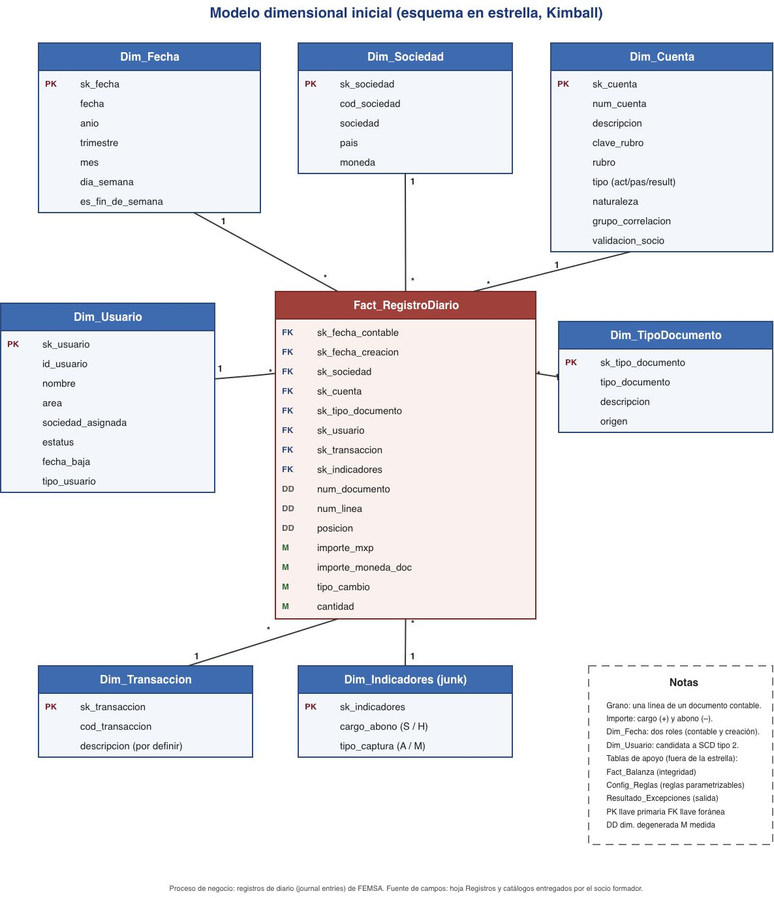

# Documento: Modelo Dimensional Conceptual (Lógico)

**Equipo 5 – TI2006B Soporte analítico para la toma de decisiones**
**Reto:** FEMSA – Auditoría Financiera
**Integrantes:** Alejandro García Cantú, Javier Gómez Oaxaca, Denzel Cervantes Parra, Víctor Manuel Castillo Gómez, Jessica Lizeth Salazar Muñoz

**Proceso de negocio:** registros de diario (*journal entries*) de FEMSA.
**Fuente de los campos:** hoja *Registros* y catálogos entregados por el socio formador.

---

## 1. Definición de la Tabla de Hechos

### `Fact_RegistroDiario`

- **Granularidad:** una línea de un documento contable.
- **Tipo:** tabla de hechos transaccional.
- **Convención de importe:** cargo (+) y abono (−).

| Atributo | Rol | Descripción |
|---|---|---|
| `sk_fecha_contable` | FK → Dim_Fecha | Fecha contable del registro. |
| `sk_fecha_creacion` | FK → Dim_Fecha | Fecha en que se capturó el registro en el sistema. |
| `sk_sociedad` | FK → Dim_Sociedad | Sociedad (empresa) que registra. |
| `sk_cuenta` | FK → Dim_Cuenta | Cuenta contable afectada. |
| `sk_tipo_documento` | FK → Dim_TipoDocumento | Tipo de documento contable. |
| `sk_usuario` | FK → Dim_Usuario | Usuario que capturó el registro. |
| `sk_transaccion` | FK → Dim_Transaccion | Código de transacción del sistema. |
| `sk_indicadores` | FK → Dim_Indicadores | Combinación de banderas (cargo/abono, tipo de captura). |
| `num_documento` | Dimensión degenerada | Número de documento contable. |
| `num_linea` | Dimensión degenerada | Número de línea dentro del documento. |
| `posicion` | Dimensión degenerada | Posición de la línea en el documento. |
| `importe_mxp` | Medida (aditiva) | Importe en pesos mexicanos. |
| `importe_moneda_doc` | Medida (aditiva por moneda) | Importe en la moneda original del documento. |
| `tipo_cambio` | Medida (no aditiva) | Tipo de cambio aplicado. |
| `cantidad` | Medida (aditiva) | Cantidad asociada a la línea. |

## 2. Definición de las Tablas de Dimensiones

### `Dim_Fecha`: ¿cuándo? (rol múltiple: contable y creación)
| Atributo | Descripción |
|---|---|
| `sk_fecha` (PK) | Llave sustituta. |
| `fecha` | Fecha completa. |
| `anio` | Año. |
| `trimestre` | Trimestre (1–4). |
| `mes` | Mes (1–12). |
| `dia_semana` | Día de la semana. |
| `es_fin_de_semana` | Indica si es sábado o domingo. |

### `Dim_Sociedad`: ¿en qué empresa?
| Atributo | Descripción |
|---|---|
| `sk_sociedad` (PK) | Llave sustituta. |
| `cod_sociedad` | Código de la sociedad. |
| `sociedad` | Nombre de la sociedad. |
| `pais` | País. |
| `moneda` | Moneda local de la sociedad. |

### `Dim_Cuenta`: ¿qué cuenta?
| Atributo | Descripción |
|---|---|
| `sk_cuenta` (PK) | Llave sustituta. |
| `num_cuenta` | Número de cuenta contable. |
| `descripcion` | Nombre / descripción de la cuenta. |
| `clave_rubro` | Clave del rubro contable. |
| `rubro` | Rubro contable. |
| `tipo` | Activo, pasivo o resultados. |
| `naturaleza` | Naturaleza deudora o acreedora. |
| `grupo_correlacion` | Grupo de cuentas correlacionadas. |
| `validacion_socio` | Validación del socio formador sobre la cuenta. |

### `Dim_TipoDocumento`: ¿qué tipo de documento?
| Atributo | Descripción |
|---|---|
| `sk_tipo_documento` (PK) | Llave sustituta. |
| `tipo_documento` | Clave del tipo de documento. |
| `descripcion` | Descripción del tipo. |
| `origen` | Origen del documento. |

### `Dim_Usuario`: ¿quién lo registró? (candidata a SCD tipo 2)
| Atributo | Descripción |
|---|---|
| `sk_usuario` (PK) | Llave sustituta. |
| `id_usuario` | Identificador del usuario en el sistema. |
| `nombre` | Nombre del usuario. |
| `area` | Área a la que pertenece. |
| `sociedad_asignada` | Sociedad sobre la que tiene permisos. |
| `estatus` | Activo / inactivo. |
| `fecha_baja` | Fecha de baja, si aplica. |
| `tipo_usuario` | Tipo de usuario (p. ej. de diálogo o de sistema). |

### `Dim_Transaccion`: ¿con qué transacción?
| Atributo | Descripción |
|---|---|
| `sk_transaccion` (PK) | Llave sustituta. |
| `cod_transaccion` | Código de la transacción del sistema. |
| `descripcion` | Descripción (por definir con el socio formador). |

### `Dim_Indicadores` (junk dimension): ¿cómo se capturó?
| Atributo | Descripción |
|---|---|
| `sk_indicadores` (PK) | Llave sustituta. |
| `cargo_abono` | S = cargo (*Soll*), H = abono (*Haben*). |
| `tipo_captura` | A = automática, M = manual. |

### Tablas de apoyo (fuera de la estrella)
- **`Fact_Balanza`:** saldos de la balanza para validar la integridad de los registros.
- **`Config_Reglas`:** reglas de auditoría parametrizables (umbrales, combinaciones prohibidas).
- **`Resultado_Excepciones`:** salida con los registros que incumplen alguna regla.

## 3. Dibujo del Modelo Dimensional Conceptual (Lógico)

**Leyenda:** PK = llave primaria · FK = llave foránea · DD = dimensión degenerada · M = medida.

## 4. Preguntas de análisis que responde el modelo

- ¿Qué registros se capturaron en fin de semana o con gran desfase entre fecha contable y de creación?
- ¿Qué usuarios dados de baja o fuera de su sociedad asignada siguen registrando movimientos?
- ¿Qué cuentas tienen movimientos contrarios a su naturaleza?
- ¿Qué sociedades, tipos de documento o transacciones concentran capturas manuales de alto importe?
- ¿Cuadran los registros de diario contra la balanza (`Fact_Balanza`)?
