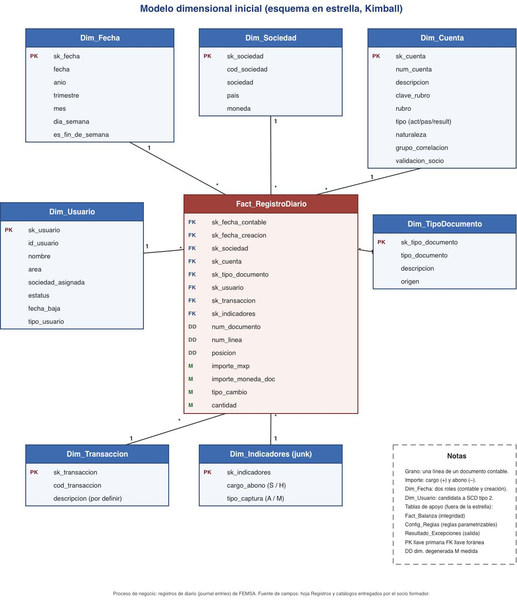

# Modelo Dimensional Lógico – Equipo 5

**Reto:** FEMSA – Auditoría Financiera (detección de registros contables atípicos)
**Materia:** TI2006B – Soporte analítico para la toma de decisiones

📄 Documento completo (Parte B): [`Documento_Modelo_Dimensional.md`](Documento_Modelo_Dimensional.md)

---

## A.1 Pasos de la metodología de Kimball para el diseño conceptual

| Paso | Descripción | Aplicación en nuestro reto |
|---|---|---|
| **1. Seleccionar el proceso de negocio** | Identificar la actividad operativa que genera los datos a analizar. | Registros de diario (*journal entries*) contables de FEMSA. |
| **2. Declarar la granularidad** | Definir qué representa exactamente una fila de la tabla de hechos. | Una línea de un documento contable. |
| **3. Identificar las dimensiones** | Definir los contextos descriptivos (quién, qué, cuándo, dónde, cómo). | Fecha (contable y de creación), Sociedad, Cuenta, Tipo de documento, Usuario, Transacción e Indicadores. |
| **4. Identificar los hechos** | Definir las medidas numéricas coherentes con la granularidad. | Importe en MXN, importe en moneda del documento, tipo de cambio y cantidad. |

El resultado es un **esquema en estrella**: la tabla de hechos `Fact_RegistroDiario` al centro, conectada a dimensiones desnormalizadas.

## A.2 Objeto de estudio

Los **registros de diario contables de FEMSA**, con el fin de apoyar al área de **Auditoría Financiera** en la detección de registros atípicos o de riesgo (por ejemplo, capturas manuales, registros en fin de semana, usuarios dados de baja o sin autorización sobre la sociedad, cuentas fuera de su naturaleza) y en la validación de la integridad contra la balanza.

## A.3 Granularidad de la tabla acondicionada

**Una fila = una línea (posición) de un documento contable**, identificada por la combinación `num_documento` + `num_linea` / `posicion` dentro de una sociedad.

Se eligió el nivel más atómico porque la auditoría necesita revisar cada movimiento individual; desde ahí se puede agregar por documento, cuenta, sociedad, usuario o periodo.

## A.4 Métricas identificadas

| Métrica | Tipo | Descripción |
|---|---|---|
| `importe_mxp` | Aditiva | Importe de la línea en pesos mexicanos. Cargo (+) y abono (−). |
| `importe_moneda_doc` | Aditiva (por moneda) | Importe en la moneda original del documento; solo se suma dentro de una misma moneda. |
| `tipo_cambio` | No aditiva | Tipo de cambio aplicado; se promedia o se analiza, nunca se suma. |
| `cantidad` | Aditiva | Cantidad asociada a la línea. |

Como los cargos son positivos y los abonos negativos, la suma de `importe_mxp` por documento debe ser 0, lo que sirve como validación de integridad.

## A.5 Perspectivas de análisis (dimensiones)

| Dimensión | Pregunta | Ejemplo de análisis de auditoría |
|---|---|---|
| **Dim_Fecha** (rol contable y rol creación) | ¿Cuándo? | Registros en fin de semana; desfase entre fecha contable y fecha de creación. |
| **Dim_Sociedad** | ¿En qué empresa / país? | Sociedades con más excepciones o montos atípicos. |
| **Dim_Cuenta** | ¿Qué cuenta? | Movimientos contrarios a la naturaleza de la cuenta; rubros con más riesgo. |
| **Dim_TipoDocumento** | ¿Qué tipo de documento? | Tipos de documento u origen con más registros atípicos. |
| **Dim_Usuario** | ¿Quién lo registró? | Usuarios dados de baja que siguen registrando; usuarios fuera de su sociedad asignada. |
| **Dim_Transaccion** | ¿Con qué transacción del sistema? | Códigos de transacción poco frecuentes o inusuales. |
| **Dim_Indicadores** (junk) | ¿Cómo se capturó? | Cargo/abono (S/H) y captura automática vs manual (A/M). |

## A.6 Diseño conceptual del modelo dimensional

**Notas del diseño:**
- `Dim_Fecha` es una dimensión de **rol múltiple** (*role-playing*): se usa como fecha contable y como fecha de creación.
- `Dim_Usuario` es candidata a **SCD tipo 2** para conservar el historial de área, estatus y sociedad asignada.
- `Dim_Indicadores` es una **junk dimension** que agrupa banderas de baja cardinalidad.
- `num_documento`, `num_linea` y `posicion` son **dimensiones degeneradas** dentro de la tabla de hechos.
- **Tablas de apoyo fuera de la estrella:** `Fact_Balanza` (integridad), `Config_Reglas` (reglas parametrizables) y `Resultado_Excepciones` (salida).
